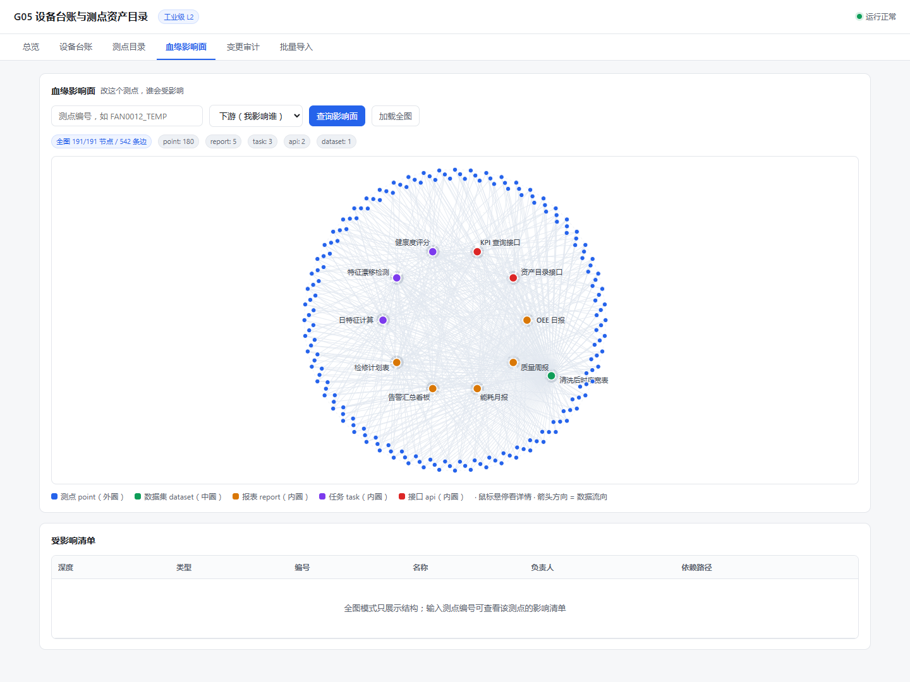
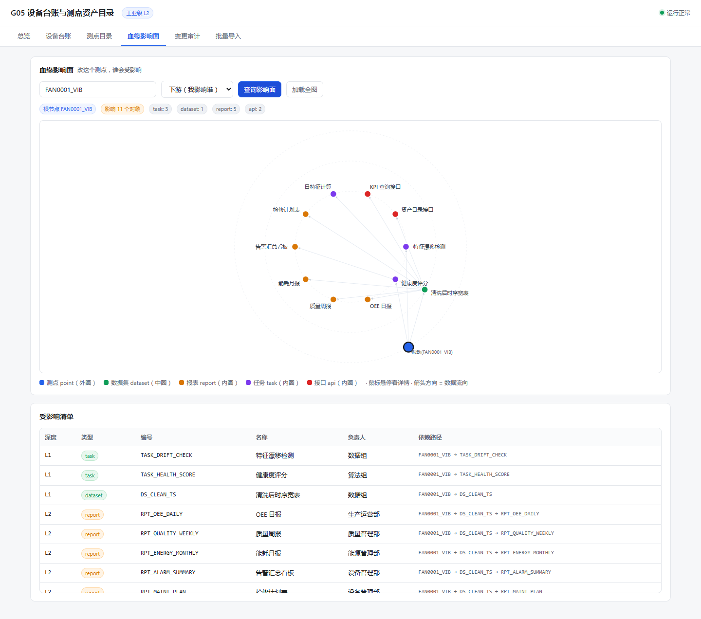

# B2 #26 页面验收补证（2026-11-11）

## 范围与版本

- 被测 main：`d64c83fafc1f7ac9c11ee1f9bcb352d45064d5b1`。
- 隔离工作树、独立 SQLite，使用仓库 `scripts/seed_data.py` 的合成数据，不使用真实工业数据或个人资料。
- Windows、Python 3.11、Chrome、1440×1080 CSS viewport。只读核验产品代码，没有产品代码改动。
- 本次仅为 B2 #26 证据，不代表整个项目最终验收，也不代替 A 的核收决定。

## 实测结果

1. 真实 FastAPI 后端返回全图 **191/191 节点、542 条边**，`truncated=false`；点180、数据集1、报表5、任务3、API2。issue 描述中的193为历史描述，本次以实际响应为准，满足≥150。
2. 全图仅显示11个关键节点标签。对11个 SVG text 的浏览器实际 bounding boxes 两两检查，**相交0对**；截图目视未见大面积标签重叠。标签与边线交叉不在该数值统计中，密集边线仍会影响读图体验。
3. 外圈测点、中圈数据集、内圈消费方；542条边均含箭头 marker。根查询 FAN0001_VIB 后1个根节点有粗边框高亮。
4. 所有191个节点的 SVG title 均含类型、业务键、负责人；五种类型分别执行了 hover，读取标题字段完整。Chrome 可访问性树也呈现这三项。
5. **边界：当前详情采用浏览器原生 SVG title。自动截图未捕获原生气泡，不能把字段存在及 hover 动作当作气泡可见截图已通过。需在普通浏览器手工悬停最终确认；本次不建议仅据此关闭 #26。**
6. 重复加载全图、刷新页面均恢复191节点；前端 pageerror 0。
7. B2 聚焦回归 `pytest tests/test_lineage.py -q -o addopts=''`：**22 passed in 1.08s**。未重新运行全仓测试或跨平台测试。

## 截图与原始证据

- [DOM测量、191个title及交互结果](metrics.json)
- [真实API合成图响应](graph.json)

## 复现

在干净隔离工作树中安装 requirements.txt 与 playwright、pytest、httpx；Windows pip 需启用 UTF-8（例如 python -X utf8 -m pip）。设置 PYTHONPATH=src，并用 G05_DATABASE__DATABASE__PATH 指向独立测试数据库，勿使用现有业务库。

1. `python -m g05 initdb`
2. `python scripts/seed_data.py`（只在新库执行，不使用 --reset）
3. `python -m g05 serve --port 8026`
4. 打开 `http://127.0.0.1:8026/#lineage`，加载全图。
5. 悬停测点 FAN0001_VIB、数据集 DS_CLEAN_TS 及报表/任务/API，检查三字段。输入 FAN0001_VIB 查询影响面，验证根高亮。

## 顺带发现（非B2，不越权改动）

`python -m g05 seed` 实际失败：seed_data.py: error: unrecognized arguments: seed。CLI 通过 runpy 调用脚本时残留子命令参数。使用仓库直接脚本入口可成功生成合成数据。本项不应写成页面缺陷，也未在本批修复。
