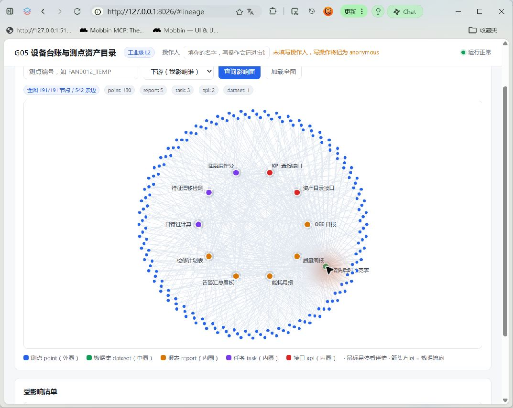

# Tabbit 可见页面复验（2026-11-11）

- 当前远端 main 为 `1b486dd98de30e62437cc4e5551abe551b23e947`（含 #68 seed参数修复），此次以新的隔离工作树运行该版本，复用独立合成QA库，未触碰业务库。
- Tabbit 页面已真实打开 `http://127.0.0.1:8026/#lineage`，实际可见191/191节点、542边，标签未出现大面积重叠；截图不是旧版本截图。
- 重新运行 `tests/test_lineage.py tests/test_cli.py`：23 passed in 1.53s。未跑全仓。
- 原生窗口通道已可读取URL，GitHub首页显示 Jasonlu555，确认是B2浏览器身份。此事实不等价于GitHub集成写权限恢复。
- 截图中没有原生hover气泡。点击节点及极小滚动将指针定位节点后，截图仍未捕获气泡；现有原生窗口工具不提供纯鼠标移动接口。保留hover可见性待验，不以截图或DOM字段存在宣称通过。
- 前次GitHub集成创建PR/评论403仍无恢复证据，未用另一路径绕过，尚未创建PR或挂入 #26。

此截图保留浏览器地址栏和应用上下文，可与前次报告核对版本与范围。未注入自制气泡、未改产品前端代码、未关闭issue。
